# Spring AI en Action — Refund Management P0-I

POC d'accompagnement du talk Spring AI en Action : domaine Refund Management, capacités Spring AI et protections transversales. Aucune opération ne déclenche un paiement.

## Versions cible
- Java 21
- Spring Boot 4.0.8
- Spring AI 2.0.1
- Java 21+

## Build et lancement local
```bash
mvn clean verify
mvn -pl refund-api -am spring-boot:run -Dspring-boot.run.profiles=demo
```
Le build et les tests unitaires/MVC sont vérifiés. Les scénarios nécessitant Ollama, PostgreSQL/pgvector et le serveur MCP restent à lancer avec ces services disponibles.

## Identités de démonstration

Le profil `demo` active les comptes fictifs suivants, réservés à l'environnement local : `alice / alice-demo`, `bob / bob-demo` et `admin / admin-demo`. Ils utilisent HTTP Basic. Alice et Bob ont le rôle `USER`; admin possède aussi `ADMIN`.

## Exemples HTTP

```bash
curl -i -u alice:alice-demo localhost:8080/api/orders/CMD-1042
curl -i -u alice:alice-demo localhost:8080/api/orders/CMD-2099 # 403 attendu
curl -i -u alice:alice-demo localhost:8080/api/orders/CMD-1050/eligibility
curl -i -X POST -u alice:alice-demo localhost:8080/api/orders/CMD-1042/refund-drafts
curl -i -u admin:admin-demo localhost:8080/actuator/metrics
curl -i -u alice:alice-demo -X POST localhost:8080/api/ai/rag/admin/ingest # 403 attendu
```

## Sécurité
Les contrôleurs obtiennent désormais l'identité depuis Spring Security ; `X-Demo-Actor` et `X-Demo-User` ne sont plus utilisés. Les comptes codés en mémoire ne sont activés qu'avec `demo`. N'exposez pas ce profil sur un réseau public. L'authentification de démonstration ne remplace pas une configuration d'identité pour un produit réel.

`/api/**` exige une authentification, l'ingestion RAG et les endpoints Actuator hors santé exigent `ADMIN`, et `/actuator/health` est public. Les appels métier vérifient encore la propriété de la commande dans les services Java.

Les appels consultatifs à `/api/ai/safe-chat` sont bornés par un timeout applicatif et retournent un statut explicite `AI_UNAVAILABLE` en cas de panne technique connue. Un timeout Java ne garantit pas l'arrêt d'une requête déjà reçue par le fournisseur. Les exceptions métier et de sécurité ne sont pas converties en succès de repli.

Les métriques applicatives sont exposées via Actuator et Prometheus. Les observations Spring AI sont configurées sans contenu de prompt, de complétion ou de Tool. Le sampling configuré ne suffit pas à exporter des traces : aucun collecteur OpenTelemetry n'est branché dans cet incrément.

## Politique fictive de test
- `LAPTOP`: fenêtre de 30 jours, justificatif requis.
- `ACCESSORY`: fenêtre de 14 jours, justificatif non requis.
- Règles datées au 2026-01-01, version 1.0.
- `EligibilityService` applique une décision Java déterministe ; le futur LLM ne pourra ni déroger à cette règle ni déclencher une transaction.

## Limites du POC
- Les comptes et mots de passe de démonstration ne conviennent pas à un environnement partagé.
- La mémoire métier des commandes reste en fixtures ; le stockage vectoriel PostgreSQL est distinct.
- Le timeout applicatif complète les timeouts réseau, mais ne les remplace pas.
- Les scénarios nécessitant Ollama, pgvector et MCP doivent être vérifiés séparément avant leur démonstration.

## Schémas principaux

Schémas Mermaid extraits de la présentation, dans l'ordre du talk. Sur GitHub, survoler un schéma affiche les contrôles pour zoomer, déplacer et agrandir.

### Une application Spring Boot. Un nouveau besoin.

L'application fonctionne déjà ; l'IA doit **s'intégrer à ses points d'extension**, pas remplacer ses services.

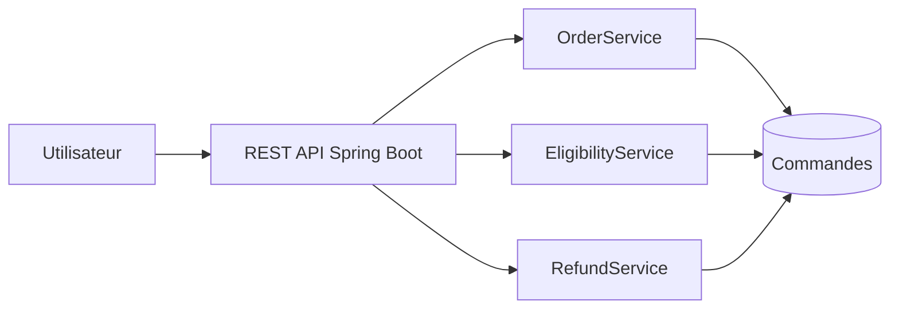

### Un appel LLM ne fait pas une intégration

Une réponse générée ne donne pas automatiquement accès aux données, aux règles ou aux autorisations de l'application.

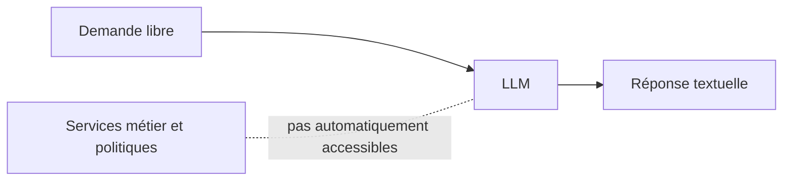

### Spring AI : intégrer les capacités des modèles dans Spring

Spring AI fournit des abstractions pour **composer les capacités des modèles** dans une application Spring Boot.

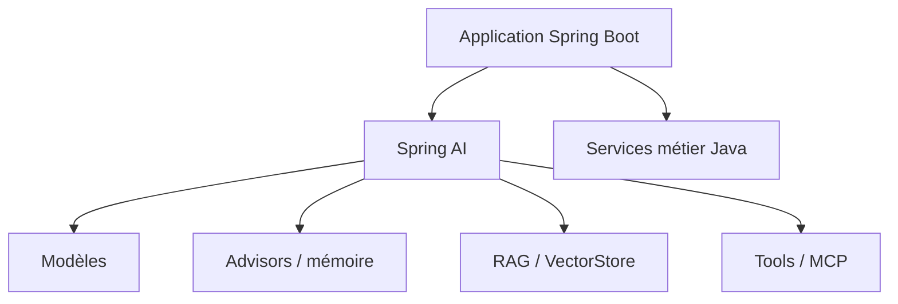

### Structured Output : validation et limites

La conversion en objet Java ne remplace pas la validation applicative.

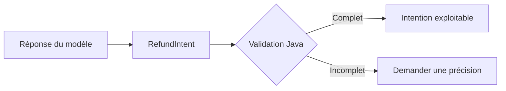

### Advisors : enrichir les interactions avec le modèle

Un Advisor est un composant Spring AI qui intercepte une interaction ChatClient pour enrichir la requête et/ou traiter la réponse.

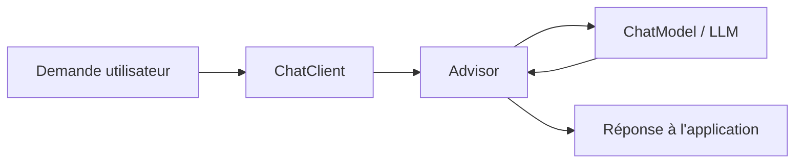

### Chat Memory : conserver le contexte conversationnel

ChatMemory conserve l'historique des échanges ; `MessageChatMemoryAdvisor` le réinjecte dans les appels au modèle, selon l'identifiant de conversation.

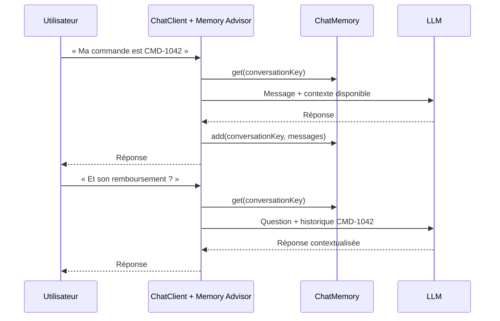

### RAG : ingestion et indexation vectorielle

Préparer les documents métier pour permettre leur recherche par similarité sémantique.

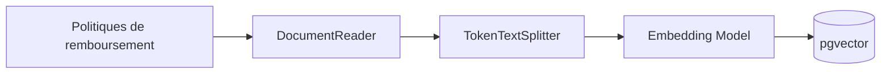

### RAG : retrieval avec QuestionAnswerAdvisor

`QuestionAnswerAdvisor` retrouve les passages pertinents dans le `VectorStore` et enrichit le prompt transmis au modèle.

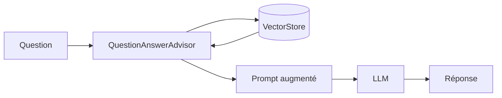

### Retrieval : évaluer et améliorer la pertinence

Le retrieval fournit des candidats. Le reranking peut améliorer leur ordre ; l'évaluation permet de vérifier si cela apporte un gain.

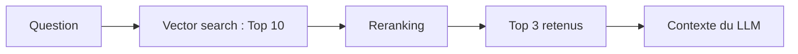

### RAG modulaire : composer le pipeline Spring AI

`RetrievalAugmentationAdvisor` permet de composer les étapes de retrieval et de traitement des documents autour du modèle.

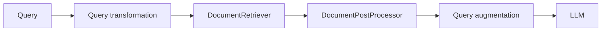

### Le RAG ne connaît pas notre commande

Connaître une politique de remboursement ne signifie pas connaître l'état d'une commande.

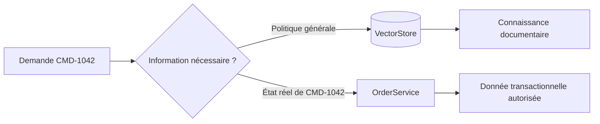

### Tool Calling : orchestrer les appels aux services Java

Le modèle demande un Tool ; `ToolCallingAdvisor` orchestre la boucle ; `ToolCallingManager` résout et exécute les appels via les `ToolCallback`.

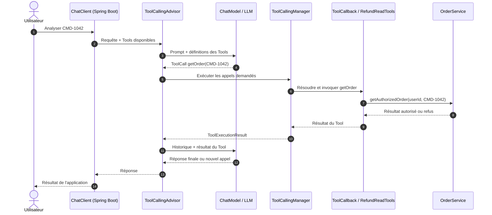

### Déclarer un Tool avec Spring AI : @Tool et ToolContext

`@Tool` rend une méthode Java disponible au modèle ; `ToolContext` transmet des informations d'exécution fournies par l'application.

```mermaid
flowchart LR
    M[LLM : orderId] --> T[@Tool getOrder]
    S[Spring Security : utilisateur] --> C[ToolContext]
    C --> T
    T --> B[OrderService : ACL]
    B --> R[OrderView]
```

### Tool Calling : le modèle propose, l'application contrôle

Un Tool déclenche une demande d'opération ; l'identité, les autorisations et les décisions métier restent contrôlées par l'application.

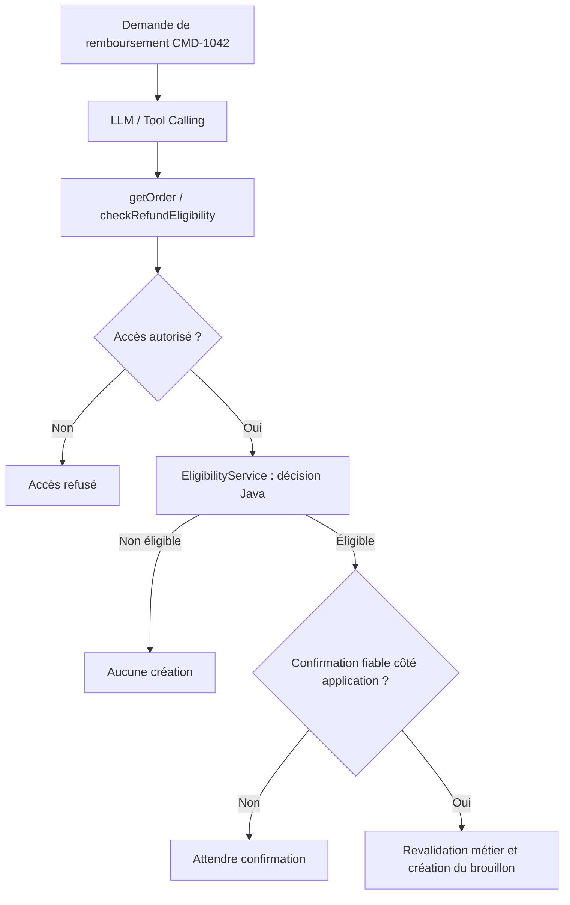

### MCP Server : exposer des capacités distantes

Un serveur MCP publie des capacités accessibles à des applications clientes via un protocole standardisé.

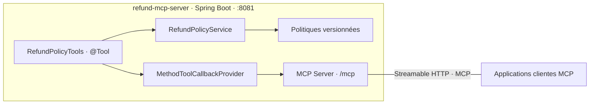

### MCP Client : découvrir et utiliser des Tools distants

Le client MCP découvre les capacités d'un serveur ; Spring AI les adapte en ToolCallbacks utilisables par ChatClient.

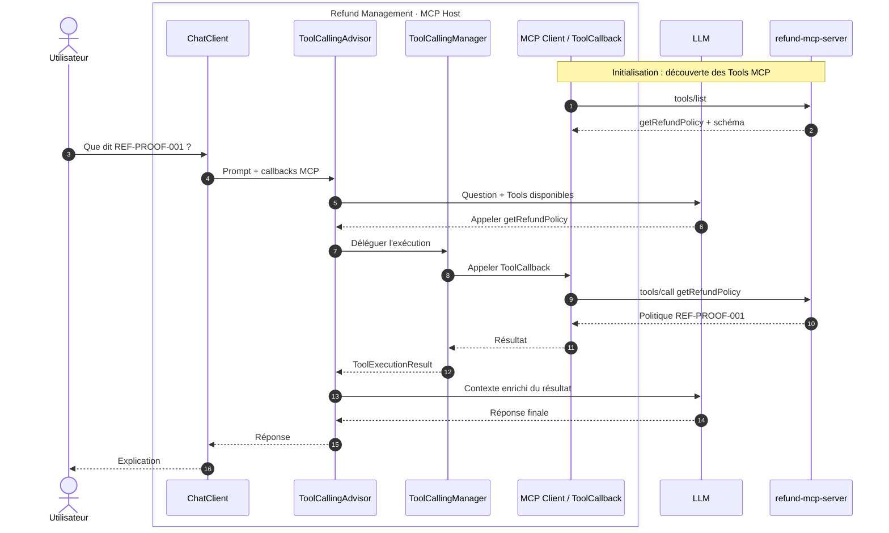

### Workflow ou agent : qui pilote l'exécution ?

Dans un workflow, **Java détermine les étapes** ; dans une boucle agentique, **le modèle choisit les Tools** disponibles au fil de son investigation.

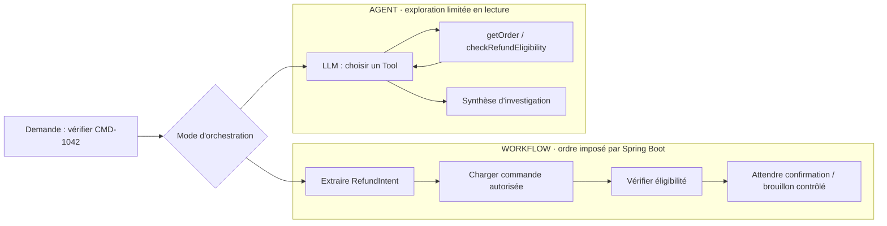

### Workflows : orchestrer avec Java et Spring AI

Un workflow déterministe combine une étape IA avec des services Java, selon un ordre fixé par l'application.

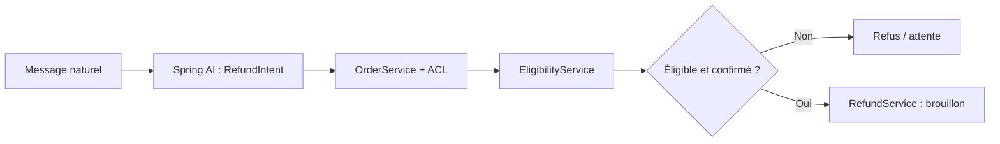

### Agentic Loop : orchestrer les Tools avec Spring AI

`ToolCallingAdvisor` orchestre la boucle LLM/Tools ; `ToolCallingManager` exécute les callbacks demandés.

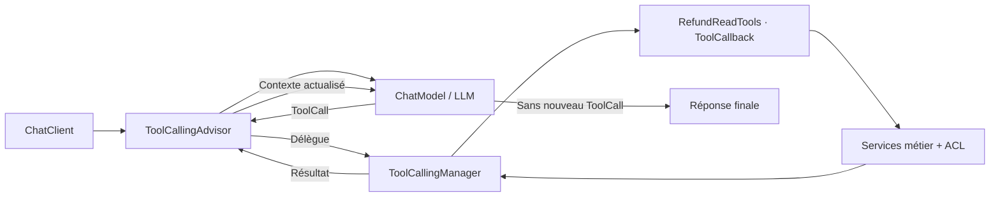

### Choisir le bon niveau d'autonomie

L'autonomie dépend du type de tâche, du risque et des contrôles disponibles — pas de la seule capacité du modèle.

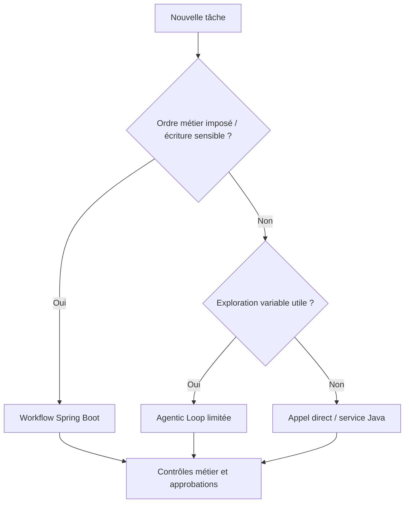

### Du POC à la production : quelles garanties ajouter ?

Un appel au modèle qui fonctionne ne garantit ni la sécurité, ni la qualité, ni la disponibilité du processus métier.

```mermaid
flowchart LR
    A["POC fonctionnel"] --> B["Sécurité"]
    B --> C["Observabilité"]
    C --> D["Évaluation"]
    D --> E["Résilience"]
    E --> F["Service exploitable"]
```

### Sécurité : authentifier l'utilisateur, autoriser chaque Tool

Spring Security établit l'identité ; le service métier applique l'autorisation. `ToolContext` transmet le contexte applicatif sans laisser le LLM choisir l'utilisateur.

```mermaid
flowchart LR
    U["Requête authentifiée"] --> S["Spring Security"]
    S --> C["ChatClient + ToolContext"]
    C --> T["@Tool getOrder"]
    T --> A{"OrderService : propriétaire autorisé ?"}
    A -->|Oui| O["OrderView"]
    A -->|Non| N["Refus d'accès"]
```

### Observability & Evaluation : voir l'exécution, mesurer la qualité

L'observabilité décrit **ce qui s'est passé** ; l'évaluation vérifie **si le résultat était bon**.

```mermaid
flowchart LR
    R["Interaction Spring AI"] --> O["Observabilité · Micrometer"]
    R --> E["Évaluation · jeux de tests"]
    O --> O1["Durées · erreurs · appels Tool"]
    E --> E1["Retrieval : Hit@K / MRR@K"]
    E --> E2["Réponse : pertinence / conformité métier"]
```

### Résilience : isoler les échecs de l'IA du métier

Timeout, limites d'exécution et réponse de dégradation empêchent une dépendance IA indisponible de provoquer une action métier non contrôlée.

```mermaid
flowchart TD
    U["Demande utilisateur"] --> G["SafeRefundAiService"]
    G --> T["AiExecutionGuard : délai / limites"]
    T --> A{"Interaction IA disponible ?"}
    A -->|Oui| R["Réponse IA contrôlée"]
    A -->|Non / délai dépassé| F["AI_UNAVAILABLE"]
    F --> S["État métier inchangé"]
```

### Spring AI : enrichir une architecture Spring Boot existante

ChatClient, RAG, Tools, MCP et orchestration s'intègrent aux services Java sans remplacer les responsabilités métier.

```mermaid
flowchart TB
    U["Utilisateur"] --> API["Refund API · Spring Boot"]
    API --> ORCH["Orchestration applicative"]

    subgraph AI["Capacités Spring AI"]
        C["ChatClient · Structured Output"]
        MEM["Advisors · Chat Memory"]
        RAG["RAG · VectorStore"]
        TOOLS["Tool Calling · ToolCallbacks"]
        MCP["MCP Host / Client"]
    end

    ORCH --> C
    C --> MEM
    ORCH --> RAG
    ORCH --> TOOLS
    ORCH --> MCP
    RAG --> PG[("Politiques · pgvector")]
    MCP <-->|"MCP"| MS["MCP Server · politiques"]
    TOOLS --> BIZ["Services Java · Order / Eligibility / Refund"]
    ORCH --> BIZ
    BIZ --> DB[("Commandes")]
    SEC["Spring Security · ACL"] -.-> API
    SEC -.-> BIZ
    OBS["Micrometer · Evaluation · Guard"] -.-> ORCH
```
